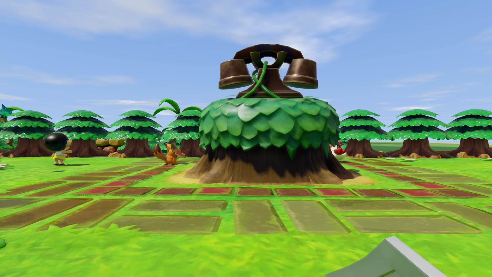
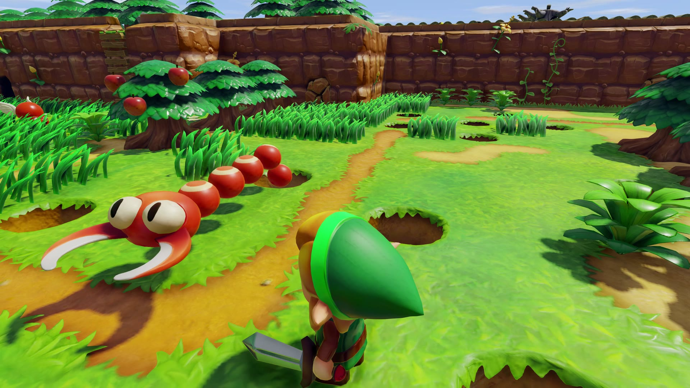
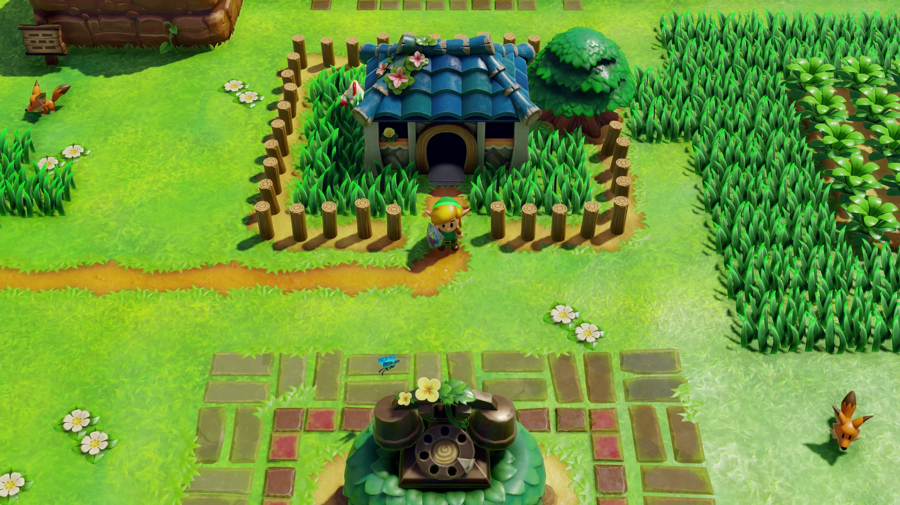

# Zelda: Inside The Dream

**A Port0r project.**

**This is a work in progress.** There will be bugs, there is no way around it. That is exactly why the whole project is
open source: anyone can take it, fix what is broken and make it better. If you build a mod on top of it, we would love to
be mentioned.

## Where it comes from

It all starts with [LAS Recomp](https://github.com/peiikai/LASRecomp), a project by Peiikai. LAS Recomp takes The Legend of
Zelda: Link's Awakening (2019) and recompiles it so that it runs natively on a PC, without an emulator. None of this would
exist without it.

Then came an idea. Link's Awakening is a dream, and we have always watched it from above. What would it feel like to be
inside that dream, standing on Koholint Island and seeing it through Link's eyes?

## What we built

Inside The Dream turns the game into a first-person game. The camera sits in Link's eyes, so you walk the beach, the
village and the dungeons at their real scale, with the sword and the shield in your hands. You can also follow Link from
behind, choose how far and how high the camera sits, and fly back up to the classic view from above whenever you want.

Most of the work went into making the island hold up when you see it from the ground. The game was only ever meant to be
seen from above. The distant scenery now has to be loaded all around you, and the sky has to reach the horizon. The tricks
the game used to hide what you were never supposed to see had to be found and removed, one by one.

It runs on three platforms:

- **Windows**: on your screen, or in VR through SteamVR (a Meta Quest works through Steam Link or Quest Link). On a fast
  monitor, the view follows your movements at the screen's own refresh rate, 165 Hz on ours, between the game's frames.
- **Linux**: on your screen, as a single AppImage.
- **Mac** with Apple Silicon: on your screen.

## The music

The music in the video is my remix of the Ballad of the Wind Fish. Two weeks ago, I bought an M-VAVE FM-1. I started
writing a software to find its firmwares and flash them on the device. Then it grew into a DAW, with a different firmware
on every track of the sequencer. This music was made with it, entirely. Everything related to the FM-1 is coming soon on
this GitHub.

Everything is on **[port0r.com](https://port0r.com)**.

## Download

| Platform | File | How you play |
| --- | --- | --- |
| Windows 10 / 11 | [`InsideTheDream-v0.1.0-windows-setup.exe`](https://github.com/jacquesdupontd/zelda-inside-the-dream/releases/download/v0.1.0/InsideTheDream-v0.1.0-windows-setup.exe) (the one-click installer), or [`InsideTheDream-v0.1.0-windows.zip`](https://github.com/jacquesdupontd/zelda-inside-the-dream/releases/download/v0.1.0/InsideTheDream-v0.1.0-windows.zip) | In VR through SteamVR, or on the screen |
| Linux (x86-64) | [`InsideTheDream-v0.1.0-linux-x86_64.AppImage`](https://github.com/jacquesdupontd/zelda-inside-the-dream/releases/download/v0.1.0/InsideTheDream-v0.1.0-linux-x86_64.AppImage) | On the screen |
| Mac (Apple Silicon) | [`InsideTheDream-v0.1.0-macos.dmg`](https://github.com/jacquesdupontd/zelda-inside-the-dream/releases/download/v0.1.0/InsideTheDream-v0.1.0-macos.dmg) | On the screen |

The checksums are in `SHA256SUMS.txt` next to the files.

## Before you start: your own copy of the game

Inside The Dream doesn't include the game. There is nothing from Nintendo in this repository or in the downloads, and we
won't tell you where to find the game. You need your own copy of Link's Awakening for Nintendo Switch, and the app takes
care of the rest.

What the app needs are the game's files, already extracted. That means two folders: `exefs`, which holds the game's
program, and `romfs`, which holds everything else (the island, the characters, the music, the text). Point the app to the
folder that contains both of them, or to a folder with their contents. A packed game file like an `.nsp`, `.xci` or `.nca`
won't work. If you give it one, the app will tell you it needs the extracted folders instead.

We play and test with version 1.0.0, the game as it first came out, without any update. Versions 1.0.1 and 1.1.0 are
accepted too.

## What your computer needs

On Windows and Linux, you need:
- a 64-bit processor with AVX2: an Intel Core from the 4th generation onwards, or any AMD Ryzen;
- a graphics card with an up-to-date Vulkan 1.3 driver;
- 8 GB of memory, or 16 if you can.

Seen through Link's eyes, the island shows much more than it ever did from above, so a stronger graphics card makes a real
difference.

To play in VR, you need a PC VR headset that works with SteamVR. A Meta Quest works too, through Steam Link or Quest Link.

On a Mac, you need an Apple Silicon Mac (M1 or newer) with macOS 15 or newer. The Mac version plays on the screen.
On an Apple Silicon Mac with a Retina screen, we recommend setting Internal resolution to 50% in Settings > Video.

Wherever you play, keep about 12 GB free on your disk for the first launch.

## Install

**Windows.**
- Download `InsideTheDream-v0.1.0-windows-setup.exe` and open it. It installs in one click, without administrator rights,
  puts an Inside The Dream shortcut on your desktop, and opens the app.
- If you'd rather not use an installer, `InsideTheDream-v0.1.0-windows.zip` holds exactly the same app. Unzip it wherever you
  like, and open `lasrecomp.exe` in the Inside The Dream folder.
- Windows may say it protected your PC, because the app isn't signed with a paid certificate. Click More info, then Run
  anyway.

**Linux.**
- Download `InsideTheDream-v0.1.0-linux-x86_64.AppImage` and make it executable, either in its Properties (Permissions) or
  with `chmod +x` in a terminal. Then open it.
- If it doesn't start, your system may be missing FUSE. Run it with `APPIMAGE_EXTRACT_AND_RUN=1` in front of the command,
  and it will start without it.

**Mac.**
- Download `InsideTheDream-v0.1.0-macos.dmg`, open it, and drag Inside The Dream into Applications.
- The first time you open it, macOS will probably refuse, because the app doesn't come from the App Store. Open System
  Settings, go to Privacy & Security, scroll down, and click Open Anyway.

## The first launch

The first time you open Inside The Dream, it shows a page called **Set up the game**:
1. Click **Choose the folder** and pick the folder with your `exefs` and `romfs`.
2. Click **Set up the game**.

The app copies what it needs from your files, then rebuilds the game's code for your own computer. This only happens once,
and it takes a few minutes: about seven on a recent desktop PC, a bit more on a laptop. Your own files are never changed.
When it's done, the start screen lets you play.

To play in VR, turn your headset on and start SteamVR first. Then click **PLAY IN VR** on the start screen. That is
Windows only.

## The three views

Inside The Dream lets you play Link's Awakening in three different ways, and you can switch between them at any moment,
in the middle of a fight or a dungeon.

When you start a game, you're in the game's own view from above, as Nintendo made it. Click the right stick to dive into
Link's eyes. You can also turn on **First-person view** in the menu, and the game will start in his eyes from then on: it
always remembers the view you left.

### Through Link's eyes

This is the heart of Inside The Dream. The camera sits in Link's eyes, with his sword and shield in front of you. You look
around with the right stick or the mouse, and the left stick walks him where you look. When you swing the sword, throw
something or talk to someone, Link turns to face where you're looking first.

On Windows and on a Mac, a screen faster than 60 Hz turns the view at its own rate, between the game's frames. That's 165
times a second on our PC monitor, and 120 on a MacBook Pro.

### Behind Link

Click the left stick, or press F5, and the camera glides back to sit a little behind and above Link, so you can see him in
the world. The sticks and the mouse work exactly the same. Click again and you're back in his eyes. In the menu, you can
choose how far behind him and how high the camera sits.

### From above, as in the original

Click the right stick and the camera flies up to the game's own view from above. It's there for a tricky puzzle, or just to
get your bearings. Click it again and you dive back into Link's eyes. A few side-view passages always keep the game's own
camera, the way they were designed.

### Switching views

| | Gamepad | Keyboard |
|---|---|---|
| Link's eyes ↔ the view from above | Click the right stick | Numpad 0 |
| Link's eyes ↔ behind Link | Click the left stick | F or F5 |
| Look around | Right stick | Mouse |
| Open Inside The Dream's menu | Press − and + together | F1 or Esc |

On a gamepad, − on its own opens the game's map, and + on its own opens the pause screen and the inventory.

## Your saves and settings

Updating or reinstalling the app keeps your saves. They live in the `save` folder, inside the app's data folder:
- on Windows, the app's own folder, which is `%LOCALAPPDATA%\Programs\Port0r\InsideTheDream` if you used the installer. If
  you use the zip, unzip new versions into the same folder;
- on Linux, `~/.local/share/lasrecomp`;
- on a Mac, `~/Library/Application Support/com.peiikai.lasrecomp`.

## Controls

You look around with the right stick or the mouse. R3 switches between the first-person view and the game's own view from
above, and L3 (or F5) puts the camera behind Link and back. On a gamepad, the left menu button (−) opens the map, the right one (+) opens the pause and the inventory, and pressing
both together opens Inside The Dream's own menu.
In the headset, you start the game with PLAY IN VR on the start screen.

The full list is in [docs/CONTROLS.md](docs/CONTROLS.md).

## Build it yourself

The whole source is here. [docs/BUILD.md](docs/BUILD.md) explains how to build each platform.

## Credits

Zelda: Inside The Dream is made as part of Port0r. It is built on LAS Recomp by Peiikai,
which recompiles the game for PC, with the randomizer of Owen_Splat; the first-person view and the VR are this project's
work. Every component and its license is in [THIRD-PARTY-NOTICES.md](THIRD-PARTY-NOTICES.md).

## More from the same author

Port0r rebuilds arcade games in 3D for VR headsets, and Sega Rally, Daytona USA, Scud Race, Virtua Cop, Time Crisis and
more are on [port0r.com](https://port0r.com).

## Legal

The Legend of Zelda and Link's Awakening are trademarks of Nintendo. Zelda: Inside The Dream is a free fan project, not
affiliated with or endorsed by Nintendo, and it contains no Nintendo content. Our code is under the MIT license
([LICENSE](LICENSE)), which keeps LAS Recomp's own MIT notice.
