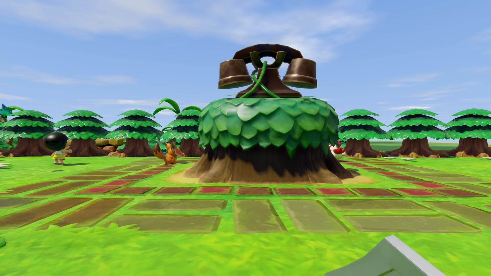
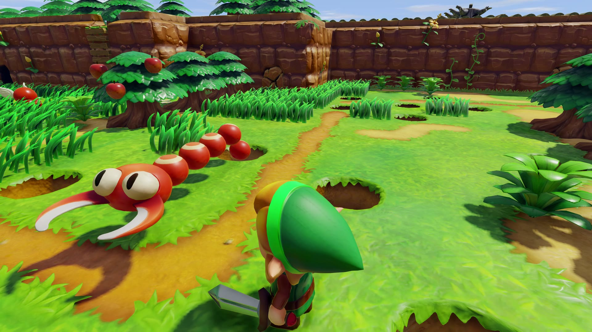
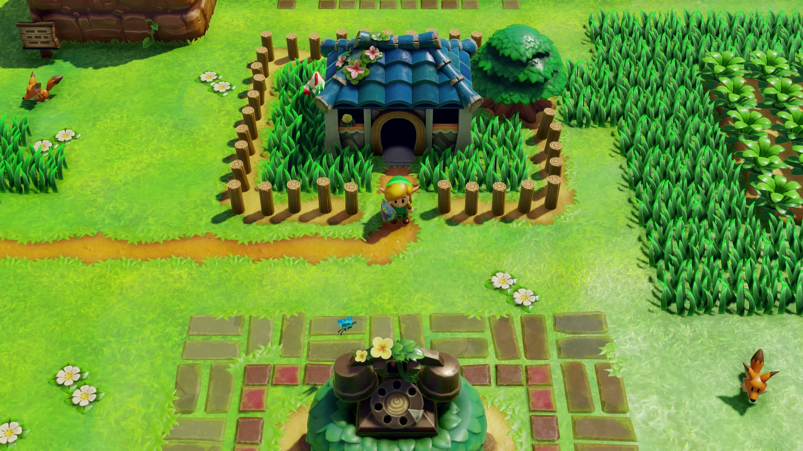
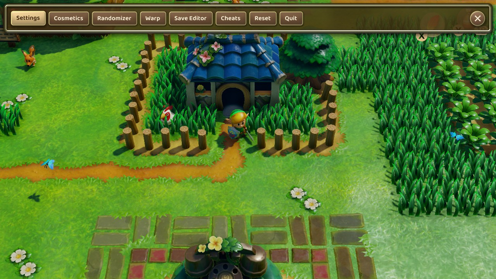
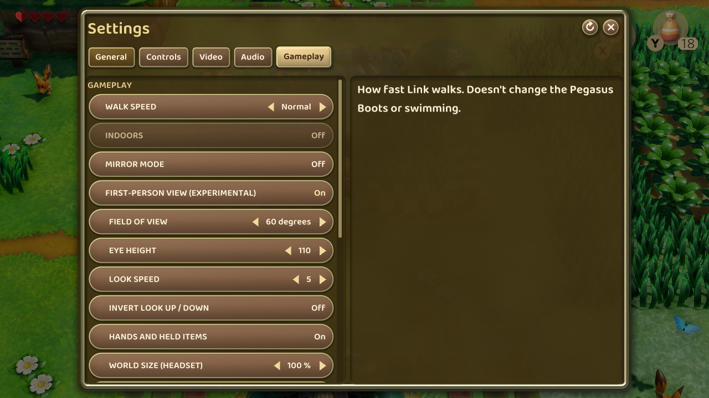

# Controls

Inside The Dream keeps LAS Recomp's controls (see [LAS-RECOMP-README.md](LAS-RECOMP-README.md)) and adds these:

- On a gamepad, the left menu button (−) opens the map, the right one (+) opens the pause and the inventory, and pressing
  both together opens Inside The Dream's own menu.
- You look around with the right stick or the mouse; the right stick is yours: it only moves the camera.
- R3 (clicking the right stick) switches from the first-person view to the game's own view from above, and back, at any time.
- L3 (clicking the left stick), F5 or the menu puts the camera behind Link, and back to his eyes.
- In the headset, a short press on the left stick is L3, and a half-second press opens the map.
- In the headset, a long press on the left menu button opens LAS Recomp's menu on the floating screen, and you move
  through it with the controllers.
- The first-person settings have « Eye distance », « Behind: distance » and « Behind: height ». In the headset, the
  Gameplay tab adds « World size (headset) » and « Hands and held items ».

## The three views

Inside The Dream lets you play Link's Awakening in three different ways, and you can switch between them at any moment,
in the middle of a fight or a dungeon.

When you start a game, you're in the game's own view from above, as Nintendo made it. Click the right stick to dive into
Link's eyes. You can also turn on **First-person view** in the menu, and the game will start in his eyes from then on: it
always remembers the view you left.

### Through Link's eyes

This is the heart of Inside The Dream. The camera sits in Link's eyes, with his sword and shield in front of you. You look
around with the right stick or the mouse, and the left stick walks him where you look. When you swing the sword, throw
something or talk to someone, Link turns to face where you're looking first.

On Windows and on a Mac, a screen faster than 60 Hz turns the view at its own rate, between the game's frames. That's 165
times a second on our PC monitor, and 120 on a MacBook Pro.

### Behind Link

Click the left stick, or press F5, and the camera glides back to sit a little behind and above Link, so you can see him in
the world. The sticks and the mouse work exactly the same. Click again and you're back in his eyes. In the menu, you can
choose how far behind him and how high the camera sits.

### From above, as in the original

Click the right stick and the camera flies up to the game's own view from above. It's there for a tricky puzzle, or just to
get your bearings. Click it again and you dive back into Link's eyes. A few side-view passages always keep the game's own
camera, the way they were designed.

### Switching views

| | Gamepad | Keyboard |
|---|---|---|
| Link's eyes ↔ the view from above | Click the right stick | Numpad 0 |
| Link's eyes ↔ behind Link | Click the left stick | F or F5 |
| Look around | Right stick | Mouse |
| Open Inside The Dream's menu | Press − and + together | F1 or Esc |

On a gamepad, − on its own opens the game's map, and + on its own opens the pause screen and the inventory.

## The options we added to the menu

Open the menu (− and + together, or F1), choose **Settings**, then the **Gameplay** tab. Everything about the first-person
view is grouped under **First-person view**.

- **First-person view**: on, the game plays through Link's eyes; off, it's the original view from above. Clicking the
  right stick switches it at any time.
- **Field of view** (60 degrees by default): how much of the world you see, from top to bottom.
- **Eye height** (110 by default): how high the eyes are. Link is about 80 tall, so 55 sees from his own eyes, and the
  default sees from a little above them.
- **Look speed** (5 by default): how fast the right stick and the mouse turn the view.
- **Invert look up / down**: for players who like to pull up to look down.
- **Hands and held items** (on by default): Link's arms, sword and shield in front of you. Turn it off to put them away.
- **World size (headset)** (100% by default): in VR, how big the island feels around you. Lower and everything looks
  smaller, as if you stood taller. Higher and it all feels bigger and closer.
- **Distant mountains** (on by default): the Tal Tal range and the Wind Fish's egg on the horizon, beyond what the game
  draws on its own.

Further down the same tab, you'll find the view from behind and its own settings:

- **View from behind** (off by default): the camera behind and a little above Link instead of in his eyes. F5 or a click
  of the left stick switches it while you play.
- **Eye distance** (0 by default): in the view from his eyes, how far behind them the camera sits. At 0, you are his eyes.
- **Behind: distance** (240 by default): in the view from behind, how far back the camera sits. Indoors it comes three
  quarters as close.
- **Behind: height** (70 by default): in the view from behind, how high above his eyes the camera sits.

Every option shows its own explanation on the right side of the menu while it's selected.
